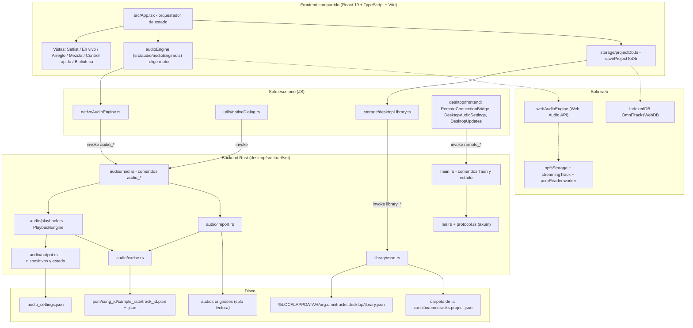
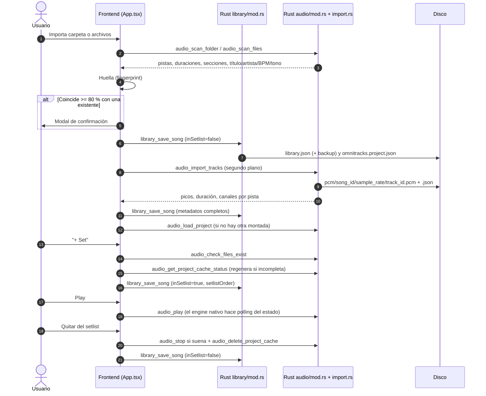

# Manual Técnico y de Arquitectura — OmniTracks

Referencia técnica de **OmniTracks** (reproductor multipista / DAW en vivo). Su objetivo es que cualquier desarrollador o IA pueda entender el sistema, localizar cualquier pieza y extenderlo con seguridad.

- Para empezar rápido (estado del repo, mapa de archivos, comandos, reglas): [`instrucciones.md`](instrucciones.md).
- Diseño detallado del motor de audio: [`docs/MOTOR_NATIVO_DISENO.md`](docs/MOTOR_NATIVO_DISENO.md).
- Empaquetado, firma y publicación: [`desktop/README.md`](desktop/README.md).

> **Principio:** si este manual y el código discrepan, gana el código. Todas las afirmaciones de este documento fueron contrastadas con el código fuente (ver nota de verificación al final).

---

## 1. Visión general

OmniTracks reproduce varias pistas (*stems*) sincronizadas al muestreo (WAV, MP3, FLAC, M4A, OGG, AAC) pensadas para conciertos: saltos de sección cuantizados al compás, bucles *Vamp*, cambio de tono/velocidad sin clics, metrónomo y guía hablada por una salida independiente (*Split-Mono*), mezcla por pista y control remoto desde teléfonos.

Dos plataformas comparten el mismo frontend React:

| | Escritorio (Windows x64) — producto principal | Web (navegador) |
|---|---|---|
| Contenedor | Tauri v2 + WebView2 | Build estático Vite (`dist/`) |
| Motor | Rust: `cpal` (WASAPI) + `symphonia` + `rubato` + `rtrb` | Web Audio API (`audioEngine.ts`) |
| Modos | Caché PCM en disco + hilos feeder por pista | `buffer` (RAM, presupuesto 256–4096 MB, defecto 1200) y `stream` (OPFS + `SyncAccessHandle` en Worker) |
| Datos | `library.json` + sidecars en disco | IndexedDB `OmniTracksWebDB` + OPFS |
| Control remoto | Servidor LAN en Rust (TCP 8765) | No disponible |

### Modelo de dos niveles
- **Biblioteca** (`library.json`): catálogo permanente. Sin audio; los originales del usuario jamás se tocan.
- **Setlist**: sesión del día, `inSetlist: true` + `setlistOrder` por canción y `activeSetlist` (ids) en `library.json`. Se vacía o edita sin afectar la biblioteca.

---

## 2. Arquitectura global



La fachada se decide al cargar `audioEngine.ts`: `isDesktopEnvironment = Boolean(window.__TAURI__)` → `nativeAudioEngine`; si no, `webAudioEngine`. `nativeAudioEngine` hace *polling* de `audio_get_playback_state` (intervalo propio) para refrescar posición, sección activa, medidores y estado del dispositivo.

---

## 3. Frontend (`src/`)

El inventario archivo por archivo con su responsabilidad está en [`instrucciones.md`](instrucciones.md) §2.2. Aquí, solo los contratos clave.

### 3.1. `App.tsx` (estado global)
- **Biblioteca:** `projects` (todas las canciones), `projectsRef` (copia para callbacks), `currentProject` (montada en el motor).
- **Setlist:** `setlistQueue` es un `useMemo` derivado de `projects.filter(inSetlist)` ordenado por `setlistOrder`. Acciones:
  - `handleAddToSetlist(id)`: ignora si ya está; en escritorio verifica archivos originales (`audio_check_files_exist`; si faltan abre el flujo de carpeta perdida), regenera la caché PCM si `audio_get_project_cache_status` no está completa, asigna `inSetlist=true` y `setlistOrder = max+1`, y guarda con `saveProjectToDb`.
  - `handleRemoveFromSetlist(id)`: detiene si suena, expulsa la canción de la caché RAM (`evictSongFromRamCache`), **borra su caché nativa** (`deleteProjectNativeCache`), pone `inSetlist=false` y retira el id de `activeSetlist` en `library.json`.
  - `handleClearSetlist()`: aplica lo anterior a toda la cola y deja `activeSetlist = []`.
  - `handleReorderSetlist(from, to)`: reasigna `setlistOrder` y guarda.
- **Importación:** `scanNativeFolder`/`scanNativeFiles` → huella → creación o fusión de canción (si coincide con una existente conserva ediciones del usuario, secciones y mezcla) → `audio_import_tracks` en segundo plano → carga en el motor si no hay otra canción montada.
- **Atajos:** Espacio (Play/Pausa), `V` (Vamp), `1`–`9` (salto a sección). `Esc` cierra el mezclador flotante de `SetlistPageView`.
- **Vista inicial por hash:** `#setlist`, `#live`, `#arranger`, `#mixer`, `#remote`, `#library`.

### 3.2. Tipos (`src/types/project.ts`)
`QuantizeMode = '1-bar' | '2-bars' | 'section-end' | 'immediate'` · `OutputBus = 'main' | 'cue-click' | 'both'` · `SplitRoutingMode = 'stereo' | 'split-mono'` · `AudioEngineMode = 'buffer' | 'stream'` · `RepertoireFolder = 'imported' | 'setlist' | 'demos'` · además `SongProject`, `TrackChannel`, `SongSection`, `TransportState`, `RemoteSyncMessage`.

### 3.3. Persistencia (`src/storage/`)
`saveProjectToDb(song)` es el **único punto de escritura**:
- **Escritorio:** `saveDesktopSong` → comando `library_save_song`.
- **Web:** IndexedDB (`OmniTracksWebDB`, stores `projects` y `audioBuffers`), memoria de presets en `localStorage`, sidecar vía File System Access cuando hay permisos (con *debounce*).

### 3.4. Huella de canción (`src/audio/fingerprint.ts`)
`findSongFingerprintMatches(incomingTracks, existingSongs)` devuelve candidatos con `matchRatio ≥ 0.80`, ordenados:
1. Descarta canciones cuyo número de pistas difiere en más de **±1**.
2. Empareja pistas una a una (sin reutilizar) cuando coinciden **duración** (±1 s) **y tamaño** (diferencia 0, `< 64 KB` o `< 2 %`); si falta uno de los dos datos en ambos lados, basta el otro.
3. `matchRatio = emparejadas / max(pistas entrantes, pistas existentes)`.
Un candidato abre `SongFingerprintPromptModal` para que el usuario decida (vincular a la existente o crear nueva).

### 3.5. Limpieza de títulos (`src/audio/smartAnalyzer.ts`)
`cleanSongTitleAndMetadata(raw)` transforma, por ejemplo, `Multitrack _ERES BENDITO_ ORIGINAL Jaime Murrel-G major-108bpm-440hz` en: título «Eres Bendito», artista «Jaime Murrel», tono «G major», BPM 108. `inferSongMetadataFromFiles(files)` aplica la heurística a nombres de carpeta/archivos. Rust tiene su propia versión (`library::clean_song_title_and_metadata`) para el escaneo nativo: **mantener ambas coherentes**. Cubierto por `test/titleCleaning.test.ts`.

---

## 4. Ciclo de vida de una canción (escritorio)



Eliminar de la biblioteca: `library_delete_song` (quita de `library.json` y `activeSetlist`, descarga del motor si estaba cargada y borra `pcm/<song_id>`).

---

## 5. Almacenamiento en disco (escritorio)

Directorio de datos: `%LOCALAPPDATA%\org.omnitracks.desktop\` (`app_local_data_dir` de Tauri).

| Elemento | Detalle |
|---|---|
| `library.json` | `LibraryFile { version (=1), updatedAt, activeSetlist: string[], songs: LibrarySong[] }`, JSON camelCase. Escritura: `library.json.tmp` → copia previa a `library.backup.json` → `rename` atómico (con *fallback* a escritura directa). Lectura: si falta o está corrupto, se restaura desde `library.backup.json`; si tampoco sirve, error. |
| `omnitracks.project.json` | **Sidecar canónico** en la carpeta de la canción: el `LibrarySong` serializado. Se escribe con `.tmp` + `rename`; si la carpeta es de solo lectura se ignora el fallo (no es fatal). Lectura con compatibilidad del nombre heredado `.omnitracks.json`. |
| `audio_settings.json` | `AudioSettings { host ("WASAPI" por defecto), deviceName, sampleRate, bufferSize, testChannel }`. |
| `pcm/<song_id>/<sample_rate>/<track_id>.pcm` | Audio decodificado, **`i16` little-endian**, a la frecuencia del dispositivo. Pistas mono reales se guardan con 1 canal (`is_effectively_mono`, umbral lateral −40 dB). |
| `pcm/<song_id>/<sample_rate>/<track_id>.json` | `TrackPcmMetadata` (`formatVersion`=1, rutas/tamaño/fecha del original para detectar reconversión, canales, `frameCount`, `durationSec`, 320 picos de onda, `createdAt`). Escritura atómica; antes de escribir se comprueba espacio libre. |

La caché es **derivable**: puede borrarse sin pérdida (se regenera desde los originales). Se limpia al quitar una canción del setlist, al eliminarla de la biblioteca y con `audio_clean_orphan_caches` (carpetas de ids que ya no existen).

---

## 6. Motor nativo de audio (Rust)

### 6.1. Hilos y flujo de datos
```
Comandos Tauri (audio_*)  ──►  PlaybackEngine (playback.rs)
                                   │
   PCM en disco ──► hilo feeder por pista "omni-feed-<track_id>"
                         (lee, remuestrea con rubato, empalma saltos/vamp con crossfade de 8 ms)
                                   │  rtrb (búfer circular lock-free por pista)
                                   ▼
                          Callback CPAL (WASAPI): mezcla por bus, ruteo, click, guía, fade, salida
```
Detalle de tamaños de búfer, saltos y decisiones: [`docs/MOTOR_NATIVO_DISENO.md`](docs/MOTOR_NATIVO_DISENO.md).

### 6.2. Módulos
- **`output.rs`:** `AudioSettings`, `AudioEngineState` (settings + estadísticas del stream + indicadores de import), `list_hosts()`/`list_devices(host)`, tono de prueba por canal, persistencia en `audio_settings.json`.
- **`playback.rs`:**
  - *Feeders:* un hilo por pista lee el PCM, aplica el remuestreo y llena el `rtrb` respetando un horizonte de lectura.
  - *Varispeed/pitch:* `resampler.rs::TrackResampler` envuelve `rubato::SincFixedIn` (`sinc_len` 64, interpolación lineal); `set_pitch` usa `set_resample_ratio_relative` sin recrear el remuestreador.
  - *Saltos y Vamp:* `audio_queue_jump` / `audio_cancel_jump` / `audio_toggle_vamp`; empalme con crossfade `FADE_MS = 8` ms (`crossfade_frames` según frecuencia del dispositivo). Limitación conocida: ver §10.
  - *Ruteo:* cada pista tiene un `TrackBus` (`Main`, `CueClick`, `Both`).
    - **Estéreo** (por defecto): mezcla Main+Both con `masterGain` y Cue+Both+click+guía con `cueMasterGain`, ambas sobre L/R.
    - **Split-Mono:** **canal 0 (izquierdo, «in-ear») = bus Cue/Click + Both + click + guía**; **canal 1 (derecho, «principal») = bus Main + Both**; ambos sumados a mono y con el paneo de pista centrado.
  - *Click:* `metronome.rs` genera pulsos de 45 ms con ataque de 2 ms y decaimiento exponencial, con barrido de frecuencia en los primeros 35 ms: tiempo fuerte 1680→820 Hz (onda triangular), negras 1120→540 Hz, subdivisiones 840→540 Hz (senoidales); alineado a la muestra y reubicable al hacer seek.
  - *Guía (`GuideCueEngine`):* sintetiza avisos de sección sin muestras externas.
  - *Dispositivo:* el *error callback* de CPAL marca `device_disconnected`; la posición se conserva y `audio_reopen_stream` reabre el stream sin reiniciar la app (test `test_device_disconnect_and_reopen_preserves_position`).
- **`cache.rs`:** ver §5. Constantes `CACHE_FORMAT_VERSION=1`, `WAVEFORM_PEAKS_COUNT=320`, `MONO_SIDE_THRESHOLD_DB=-40`.
- **`import.rs` + `audio/mod.rs`:** decodifica con Symphonia (`features = ["all"]`) y remuestrea a la frecuencia del dispositivo. `audio_import_tracks` procesa pistas con un semáforo de `clamp(núcleos/2, 2, 4)` tareas bloqueantes (`tokio::task::spawn_blocking`), con progreso emitido como eventos de Tauri (`app.emit`) y cancelación (`audio_cancel_import`). No usa `rayon`.

### 6.3. Regla de tiempo real y estado actual
Objetivo: el callback no reserva memoria, no hace E/S ni *logging* y no se bloquea. **Realidad:** hoy reserva `Vec`s por bloque y usa `std::sync::Mutex::lock()` sobre consumers, metrónomo, guía, secciones y fade (ver [`instrucciones.md`](instrucciones.md) §4 y §6). No existe llamada explícita a MMCSS/prioridad de hilo; solo se habilita la feature `realtime` de `cpal`. Cualquier cambio en esa zona debe acercarse al objetivo, no alejarse, y validarse con los tests de `playback.rs` y una prueba de carga.

### 6.4. Dependencias Rust principales
`tauri 2` (+`tauri-plugin-dialog`, `tauri-plugin-updater`), `cpal 0.18` (feature `realtime`), `symphonia 0.5` (`all`), `rubato 0.16`, `rtrb 0.3`, `axum 0.8` (`ws`), `tokio`, `tokio-util`, `serde`/`serde_json`, `base64`, `qrcode`, `if-addrs`, `subtle` (comparación de tokens en tiempo constante), `getrandom`, `tracing`. Dev: `tokio-tungstenite`, `futures-util`.

---

## 7. Servidor LAN y protocolo remoto (`lan.rs`, `protocol.rs`, `desktop/web/`)

### 7.1. Arranque
Lo inicia el usuario desde **Conexión remota** (`RemoteConnectionBridge`). `remote_start(address)` exige una IPv4 **privada** de este equipo y escucha en `address:8765`. `remote_stop(epoch)` lo apaga. Cada arranque genera un `epoch`, un token por rol y los QR; apagar/encender los regenera y termina todas las sesiones.

### 7.2. Rutas HTTP/WS
| Ruta | Función |
|---|---|
| `GET /monitor`, `GET /mezclador` | Página del rol (`remote.html`). |
| `GET /remote.js`, `GET /remote.css` | Recursos estáticos. |
| `GET /session/{role}` | ¿Hay sesión válida (cookie)? |
| `POST /session/{role}` | Empareja con `{token}` → crea sesión y cookie. |
| `GET /ws/{role}` | WebSocket de estado/comandos. |

Roles: `monitor` (solo lectura: canción, sección, cuenta atrás, reloj, setlist) y `mezclador` (además recibe pistas, `revision`, niveles y puede enviar comandos).

### 7.3. Emparejamiento y seguridad
1. El QR codifica `http://<IP>:8765/<rol>#<token>`; el token va en el **fragmento** (no viaja en la petición HTTP).
2. La página hace `POST /session/{rol}` con el token; el servidor lo compara en tiempo constante (`subtle`) y comprueba el `Origin`.
3. Responde con cookie `lt_monitor` / `lt_mixer` (`HttpOnly; SameSite=Strict; Path=/`, valor de 43 caracteres aleatorios).
4. El WebSocket valida cookie y `Origin`; mensajes y *frames* limitados a **1024 bytes**, cuerpo HTTP limitado a 1 KB.
5. **Máximo 16 sesiones**; si se llena, una sesión nueva reutiliza el cupo de la desconectada más antigua. **Expulsar** revoca la sesión (cierre `4403`) y descarta su cola de comandos.
6. Solo el rol `mezclador` puede enviar comandos, y solo estos (`deny_unknown_fields`): `setTrackGain`, `setTrackMute`, `setTrackPan`, `setTrackSolo`, cada uno con `revision` y `trackIndex`. Ganancia válida: `0 … 3.1623` (−40 a +10 dB); paneo `−1 … +1`. **No hay comandos de transporte** (play/pausa/stop/saltos) ni de biblioteca.

### 7.4. Integración con el frontend
La UI de escritorio sondea `remote_exchange(epoch, snapshot, receipts)`: envía el estado actual (`Snapshot`: canción actual/siguiente, setlist, sección, salto en cola, vamp, reloj, pistas, niveles) y los acuses de comandos aplicados, y recibe los comandos pendientes y la lista de dispositivos. El frontend los aplica al motor y confirma con un `Outcome` (`applied`, `stale`, `superseded`, `unconfirmed`). Un comando solo se acepta si el servidor está `acceptingCommands` y su `revision` coincide con la del último estado publicado (`MixCommand::target`); si no, se descarta.

Guía operativa (firewall, aislamiento Wi-Fi, expulsión, pruebas): [`desktop/README.md`](desktop/README.md).

---

## 8. Procedimientos de mantenimiento

### 8.1. Añadir un comando IPC a Tauri (4 pasos obligatorios)
1. Implementar `#[tauri::command] pub async fn mi_comando(...)` en `audio/mod.rs`, `library/mod.rs`, `updates.rs` o `main.rs`.
2. Registrarlo en `tauri::generate_handler![...]` en [`desktop/src-tauri/src/main.rs`](desktop/src-tauri/src/main.rs).
3. Añadirlo a la lista `.commands(&[...])` de [`desktop/src-tauri/build.rs`](desktop/src-tauri/build.rs) (genera el permiso `allow-mi-comando` en `permissions/autogenerated/`, carpeta ignorada por Git).
4. Añadir `"allow-mi-comando"` a `permissions` en [`desktop/src-tauri/capabilities/desktop-remote.json`](desktop/src-tauri/capabilities/desktop-remote.json).

Invocación desde el frontend:
```ts
const invoke = (window as any).__TAURI__?.core?.invoke;
if (invoke) {
  const result = await invoke('mi_comando', { parametroCamelCase: valor });
}
```
(Tauri convierte los parámetros `snake_case` de Rust a `camelCase` en JS.)

### 8.2. Inventario de comandos IPC (todos registrados en `main.rs`, `build.rs` y la capacidad)
- **Servidor LAN:** `remote_status`, `remote_start`, `remote_stop`, `remote_kick`, `remote_exchange`.
- **Actualizaciones:** `desktop_update_check`, `desktop_update_download`, `desktop_update_install`.
- **Dispositivo/estado:** `audio_list_hosts`, `audio_list_devices`, `audio_get_config`, `audio_set_config`, `audio_get_stats`, `audio_reset_stats`, `audio_test_tone`, `audio_reopen_stream`.
- **Importación y caché:** `audio_scan_folder`, `audio_scan_files`, `audio_import_tracks`, `audio_import_folder`, `audio_import_track_bytes`, `audio_import_track_bytes_raw`, `audio_cancel_import`, `audio_get_project_cache_status`, `audio_delete_project_cache`, `audio_get_cache_stats`, `audio_clean_orphan_caches`, `audio_check_files_exist`.
- **Proyecto/transporte:** `audio_load_project`, `audio_preload_project`, `audio_switch_to_preloaded`, `audio_configure_song`, `audio_play`, `audio_pause`, `audio_stop`, `audio_seek`, `audio_get_playback_state`, `audio_queue_jump`, `audio_cancel_jump`, `audio_toggle_vamp`.
- **Mezcla y ruteo:** `audio_set_track_controls`, `audio_set_master_gains`, `audio_set_pitch`, `audio_set_metronome`, `audio_set_split_mono`.
- **Biblioteca:** `library_load`, `library_save`, `library_save_song`, `library_delete_song`, `library_update_song_folder`, `library_read_sidecar`, `library_write_sidecar`.
- Además, `dialog:allow-open` (plugin de diálogos) para los selectores nativos.

### 8.3. Reglas obligatorias para cambios de audio
- Nada de reservas, E/S, logging ni bloqueos nuevos en el callback de CPAL (y reducir los existentes cuando sea posible).
- Cambios de ratio/tono: reutilizar el `SincFixedIn` activo.
- Todo salto, seek o vamp: crossfade de 8 ms.
- El click y los saltos se miden en **muestras de canción**; mantener la alineación (±1 muestra) validada por los tests.

### 8.4. Versionado y publicación
Mantener **la misma versión** en `tauri.conf.json`, `Cargo.toml` y `desktop/package.json` (+ lockfiles). Release firmada: `desktop/build-release.ps1`, tag `desktop-v<versión>` en GitHub Releases (ver [`desktop/README.md`](desktop/README.md)). El actualizador solo se habilita si el build lleva la clave pública del canal (`updates_enabled`).

### 8.5. Añadir una vista, modal o campo a la canción
- **Vista:** ampliar `WorkspaceView` y `NAV_ITEMS` en `TopBar.tsx`, el render condicional en `App.tsx` y, si procede, el parser de hash.
- **Campo nuevo en `SongProject`:** añadirlo en `src/types/project.ts` **y** en `LibrarySong` (o `LibraryTrack` / `LibrarySongSection`) de `library/mod.rs` con `#[serde(default)]`. El frontend envía el objeto completo (`invoke('library_save_song', { song })`, sin conversión) y serde ignora los campos desconocidos: **un campo que exista solo en TypeScript no se persiste en `library.json` ni en el sidecar** (se pierde al reiniciar). `#[serde(default)]` mantiene compatibles los archivos antiguos.

---

## 9. Verificación y pruebas

1. `npm.cmd run lint` → `tsc --noEmit`.
2. `npm.cmd test` → `tsx test/titleCleaning.test.ts && tsx test/trackFingerprint.test.ts`.
3. `cargo test --locked --release --target x86_64-pc-windows-msvc --manifest-path desktop/src-tauri/Cargo.toml --no-default-features` → ≈48 tests: `playback.rs` (19: varispeed, click a la muestra, Split-Mono por bus, desconexión/reapertura, crossfade), `import.rs` (6), `cache.rs` (5), `output.rs` (4), `library/mod.rs` (4), `lan.rs` (2) y `tests/` de integración (`lan_protocol.rs` 4, `verify_manual_flow.rs` 2, `benchmark_import.rs` 2).
4. Pruebas manuales de campo (hardware real, 20 pistas, teléfonos, firewall): [`desktop/README.md`](desktop/README.md) §«Pruebas reproducibles».

---

## 10. Limitaciones y pendientes conocidos
- **Saltos cuantizados dentro del horizonte ya encolado (~600 ms):** pueden posponerse al siguiente compás; la solución prevista (*Jump Reserve Buffers*) está en [`docs/MOTOR_NATIVO_DISENO.md`](docs/MOTOR_NATIVO_DISENO.md) §10. El §1.3 de ese documento (descarte «Caso B», `stream_epoch`, `FlushAndSeek`) también es diseño no implementado y así lo indica una nota de estado.
- **Callback de audio con reservas y `Mutex`** (§6.3).
- **Sin prioridad de hilo explícita** (§6.3).
- **Restos de la plantilla AI Studio** en `package.json` (`react-example`, `@google/genai`, `express`, `dotenv`, `motion`), `.env.example`, `metadata.json` y `.aistudio/`; `npm run clean` usa `rm -rf`.
- La rama `motor-nativo` aún no se fusiona con `main`.

---

*Nota de verificación (revisión de documentación):* contrastado contra el código en la rama `motor-nativo`. `npm run lint` y `npm test` se ejecutaron y pasan; las pruebas Rust y los builds de Tauri no se re-ejecutaron en esa revisión.
