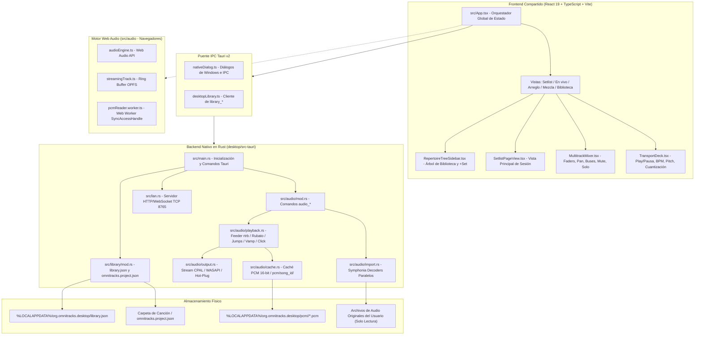
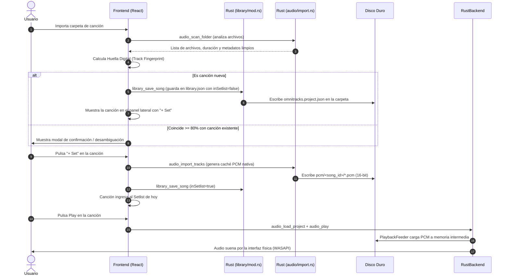

# Manual Técnico y de Arquitectura — OmniTracks (DAW & Setlist Multitrack Player)

Este documento es la **guía técnica de referencia y transferencia arquitectónica (Handoff Manual)** de OmniTracks. Su propósito es permitir que cualquier desarrollador o sistema de inteligencia artificial comprenda en profundidad el funcionamiento del sistema, cómo se interconectan todos sus archivos, el ciclo de vida del audio y los datos, y cómo extenderlo de forma segura y consistente.

---

## 1. Visión General y Propósito del Sistema

**OmniTracks** es una estación de trabajo de audio digital (DAW) y reproductor multipista especializado para escenarios y conciertos en vivo (estilo *Ableton Live / Playback / Prime / Reaper*).

### Capacidades Principales
- **Reproducción multipista con sincronización absoluta:** Admite múltiples pistas simultáneas (stems) en formatos WAV, MP3, FLAC, M4A, OGG y AAC.
- **Motor nativo de alto rendimiento en Rust (Windows Desktop):** Ejecuta la reproducción a través de un backend CPAL/WASAPI dedicado con hilo de audio en tiempo real, remuestreo dinámico con varispeed continuo sin chasquidos, y ruteo multicanal / Split-Mono.
- **Motor Web Audio API (Web / Navegador):** Modo dual con streaming por bloques desde OPFS (Origin Private File System) o decodificación completa en memoria RAM con control de presupuesto.
- **Modelo de Dos Niveles (Biblioteca Permanente vs. Setlist Efímero):**
  - La **Biblioteca** almacena el catálogo permanente en `%LOCALAPPDATA%\org.omnitracks.desktop\library.json` y sidecars visibles `omnitracks.project.json` en las carpetas de canciones. Los archivos de audio originales **jamás se tocan**.
  - El **Setlist** es la sesión del concierto o ensayo (`inSetlist: true`). Puede vaciarse («Limpiar sesión») o modificarse en vivo sin tocar la biblioteca.
- **Navegación musical en directo:** Saltos de sección cuantizados al compás (`immediate`, `1-bar`, `2-bars`, `section-end`), bucles infinitos (*Vamp*) sin saltos ni micro-cortes, metrónomo / click dinámico y avisos hablados de guía (*Cues*).
- **Servidor LAN integrado:** Un servidor HTTP/WebSocket nativo en Rust sirve páginas ligeras para teléfonos en la red local (`/monitor` para músicos y `/mezclador` para el técnico de audio).

---

## 2. Diagrama de Arquitectura Global



---

## 3. Explicación Detallada de Archivos por Capa

### 3.1. Capa de Presentación y Frontend (`src/`)

| Archivo | Responsabilidad y Funcionamiento |
|---|---|
| [`src/main.tsx`](file:///c:/Users/jpuerta/Documents/ChatGPT/Multi-chatgpt/multitrack-google/src/main.tsx) | Punto de entrada del bundle React. Monta `<App />` en el DOM (`#root`). |
| [`src/App.tsx`](file:///c:/Users/jpuerta/Documents/ChatGPT/Multi-chatgpt/multitrack-google/src/App.tsx) | **Centro neurálgico del frontend:**<br>1. Almacena el estado de la biblioteca (`projects`), canción montada (`currentProject`), setlist (`setlistQueue`), transporte y medidores.<br>2. Gestiona las acciones de setlist: `handleAddToSetlist`, `handleRemoveFromSetlist`, `handleClearSetlist` y `handleReorderSetlist`.<br>3. Orquesta la importación nativa por carpetas o archivos de audio y la resolución de ambigüedad de canciones.<br>4. Escucha atajos globales de teclado (Barra espaciadora para Play/Pausa, Escape para mixer flotante). |
| [`src/types/project.ts`](file:///c:/Users/jpuerta/Documents/ChatGPT/Multi-chatgpt/multitrack-google/src/types/project.ts) | Definiciones TypeScript para `SongProject` (canción completa), `TrackChannel` (pista/stem individual), `SongSection` (marcador de sección con tiempo y color), `TransportState`, `OutputBus` (`main` \| `cue-click` \| `both`), y `QuantizeMode` (`immediate` \| `1-bar` \| `2-bars` \| `section-end`). |
| [`src/components/TopBar.tsx`](file:///c:/Users/jpuerta/Documents/ChatGPT/Multi-chatgpt/multitrack-google/src/components/TopBar.tsx) | Barra de navegación superior con pestañas: `Setlist`, `En vivo`, `Arreglo`, `Mezcla`, `Control rápido`, `Biblioteca`. Integra el acceso al panel de conexión remota LAN y diagnóstico de audio. |
| [`src/components/TransportDeck.tsx`](file:///c:/Users/jpuerta/Documents/ChatGPT/Multi-chatgpt/multitrack-google/src/components/TransportDeck.tsx) | Barra de transporte inferior. Incluye botones de Play/Pause, Stop, Vamp (repetición en bucle de la sección actual), selectores de BPM y afinación (Pitch en semitonos), cuantización y reloj con formato `mm:ss:ms`. |
| [`src/components/RepertoireTreeSidebar.tsx`](file:///c:/Users/jpuerta/Documents/ChatGPT/Multi-chatgpt/multitrack-google/src/components/RepertoireTreeSidebar.tsx) | Panel lateral izquierdo retráctil que lista todas las canciones indexadas en la biblioteca. Permite arrastrar canciones al DAW o setlist, pulsar `+ Set` para sumarlas a la sesión, hacer clic en el `✓` (que al pasar el ratón se convierte en `✕`) para quitarlas de la sesión, y vaciar todo el setlist con el botón «Limpiar sesión actual». |
| [`src/components/SetlistPageView.tsx`](file:///c:/Users/jpuerta/Documents/ChatGPT/Multi-chatgpt/multitrack-google/src/components/SetlistPageView.tsx) | Vista de trabajo para armar el show: muestra la forma de onda maestra, las secciones de la canción activa y el orden de reproducción interactivo. Si no hay canciones en el setlist, muestra un estado limpio «Setlist vacío». Contiene el botón «Limpiar sesión» con confirmación modal. |
| [`src/components/LiveSetView.tsx`](file:///c:/Users/jpuerta/Documents/ChatGPT/Multi-chatgpt/multitrack-google/src/components/LiveSetView.tsx) | Vista optimizada para directores musicales durante el concierto: botones grandes con feedback táctil para saltar a cualquier sección, visualización de compases restantes y temporizadores de cuenta regresiva. |
| [`src/components/TimelineArranger.tsx`](file:///c:/Users/jpuerta/Documents/ChatGPT/Multi-chatgpt/multitrack-google/src/components/TimelineArranger.tsx) | Vista tradicional de secuenciador / DAW multipista con pistas apiladas horizontalmente, renderizado de formas de onda por pista, zoom y posicionamiento de marcadores de sección con precisión de milisegundos. |
| [`src/components/MultitrackMixer.tsx`](file:///c:/Users/jpuerta/Documents/ChatGPT/Multi-chatgpt/multitrack-google/src/components/MultitrackMixer.tsx) | Mesa de mezclas completa con faders de volumen logarítmicos en dB, perillas de paneo estéreo, botones Mute y Solo, asignación de canal a buses (`MAIN`, `CUE/CLICK`, `BOTH`) y medidores estéreo con caída balística a 60 fps. |
| [`src/components/LibraryAndModals.tsx`](file:///c:/Users/jpuerta/Documents/ChatGPT/Multi-chatgpt/multitrack-google/src/components/LibraryAndModals.tsx) | Agrupa los componentes de gestión de biblioteca y modales emergentes: `LibraryView`, `SongMetadataEditModal` (editor de BPM, tono, artista y título), `ConfirmSongActionModal`, `SongFingerprintPromptModal` y `SectionEditorModal`. |

---

### 3.2. Capa de Persistencia y Almacenamiento

| Archivo | Responsabilidad |
|---|---|
| [`src/storage/desktopLibrary.ts`](file:///c:/Users/jpuerta/Documents/ChatGPT/Multi-chatgpt/multitrack-google/src/storage/desktopLibrary.ts) | Comunica el frontend con el módulo nativo de Rust (`library_*`). Gestiona la carga y guardado de `library.json`, eliminación segura de canciones y sincronización del sidecar `omnitracks.project.json`. |
| [`src/storage/projectDb.ts`](file:///c:/Users/jpuerta/Documents/ChatGPT/Multi-chatgpt/multitrack-google/src/storage/projectDb.ts) | Capa intermedia que bifurca la persistencia: en escritorio utiliza `desktopLibrary.ts`, mientras que en navegadores web utiliza IndexedDB (`OmniTracksWebDB`). |
| [`src/utils/trackFingerprint.ts`](file:///c:/Users/jpuerta/Documents/ChatGPT/Multi-chatgpt/multitrack-google/src/utils/trackFingerprint.ts) | Genera la huella digital de una canción basándose en el número de pistas ($\pm 1$) y la coincidencia de tamaño en bytes y duración ($\ge 80\%$). Si se detecta una coincidencia exacta, vincula la carpeta sin duplicar; si hay ambigüedad, lanza una solicitud de confirmación al usuario. |
| [`src/utils/titleCleaning.ts`](file:///c:/Users/jpuerta/Documents/ChatGPT/Multi-chatgpt/multitrack-google/src/utils/titleCleaning.ts) | Limpia automáticamente títulos sucios como `"Multitrack _ERES BENDITO_ ORIGINAL Jaime Murrel - G major - 108bpm - 440hz"` transformándolos en: Título: `"Eres Bendito"`, Artista: `"Jaime Murrel"`, BPM: `108`, Tono: `"G Major"`. |

---

### 3.3. Capa de Backend Nativo en Rust (`desktop/src-tauri/`)

El backend de Rust proporciona aislamiento del motor de audio frente a la recolección de basura de JavaScript y el throttling de los navegadores.

#### Submódulo de Biblioteca (`desktop/src-tauri/src/library/mod.rs`)
- **`library.json`:** Estructura atómica con control de versión y copia de respaldo automática (`library.backup.json`). Se escribe primero en un archivo temporal `.tmp` y se renombra atómicamente para prevenir corrupción si el equipo pierde energía.
- **Sidecar Canónico (`omnitracks.project.json`):** Se escribe directamente en la carpeta de origen de los stems. Contiene las secciones, colores, balance de mezcla y tonalidad. Si existe el nombre heredado `.omnitracks.json`, el sistema lo lee por compatibilidad pero guarda siempre el nombre canónico visible.
- **`library_save_song`:** Sincroniza bidireccionalmente el array `active_setlist` en `library.json`: cuando una canción se marca con `in_setlist: false`, se purga automáticamente de la lista activa del show.

#### Submódulo de Audio (`desktop/src-tauri/src/audio/`)
1. **`output.rs` (Control de Dispositivo y Stream CPAL):**
   - Configura streams de audio mediante CPAL (Windows WASAPI compartido o exclusivo).
   - El hilo de audio se configura con prioridad de tiempo real (`AvSetMmThreadCharacteristicsW` en Windows para perfil `"Pro Audio"`).
   - **Manejo de Hot-Unplug en caliente:** Si la interfaz física (por ejemplo, Focusrite Scarlett) se desconecta durante el concierto, el motor detecta el fallo en el callback, conmuta a estado desconectado conservando la posición exacta del cursor (`playback_sample`), y permite reabrir el stream sin reiniciar la app.
   - **Regla estricta:** Cero alocaciones de memoria y cero llamadas a `tracing::info!` dentro del callback de audio.
2. **`playback.rs` (Procesamiento y Renderizado de Audio):**
   - **`PlaybackFeeder`:** Hilo secundario que lee la caché PCM desde disco y llena un búfer circular en anillo *lock-free* (`rtrb`) de tamaño acotado.
   - **Varispeed Continuo (`Rubato`):** Cada pista posee una instancia persistente de `rubato::SincFixedIn`. Al cambiar la afinación en tiempo real (por ejemplo +1 semitono), se ajusta el ratio con `set_resample_ratio_relative` conservando los remanentes de muestras entre bloques, eliminando cualquier chasquido o discontinuidad acústica.
   - **Saltos de Sección Cuantizados y Vamp:** Al solicitar un salto de sección, el motor calcula el compás de destino y aplica un micro-crossfade de 8 ms para evitar clics. En modo Vamp, el motor entra en bucle cerrado continuo de la sección sin interrupción.
   - **Metrónomo y Cues:** Generación analítica de pulsos sinusoidales de metrónomo (1000 Hz en pulso fuerte, 800 Hz en pulsos débiles) y síntesis de campanadas guía sin sobrecarga de CPU.
   - **Ruteo Split-Mono:** Distribución independiente de pistas hacia canal izquierdo (música) y canal derecho (click y guía) según el bus asignado (`OutputBus`).
3. **`cache.rs` (Caché PCM Nativa en Disco):**
   - Almacena audio decodificado en formato PCM crudo con enteros de 16 bits (`i16`) en `%LOCALAPPDATA%\org.omnitracks.desktop\pcm\<song_id>\<track_id>.pcm`.
   - **Preservación Mono Real:** Las pistas mono se detectan y almacenan con 1 solo canal (reduciendo el consumo de disco y RAM al 50%).
4. **`import.rs` (Decodificación Multihilo con Symphonia):**
   - Decodifica archivos MP3, WAV, FLAC, M4A, etc., en paralelo usando todos los núcleos de CPU disponibles con `rayon` / `tokio`.
   - Remuestrea al vuelo a la frecuencia de muestreo del dispositivo de salida si difiere de la del archivo original.

---

## 4. Ciclo de Vida de una Canción (End-to-End)



---

## 5. Protocolo y Servidor LAN (`desktop/src-tauri/src/lan.rs`)

OmniTracks incluye un servidor HTTP y WebSocket autónomo en Rust que permite a los miembros de la banda conectarse desde sus teléfonos móviles sin instalar ninguna aplicación.

- **Puerto:** TCP `8765` en la interfaz IPv4 seleccionada de la computadora.
- **Rutas Servidas:**
  - `http://<IP>:8765/monitor`: Interfaz ligera de solo lectura para músicos en el escenario. Muestra el título actual, sección en curso, cuenta regresiva de compases, BPM y tonalidad.
  - `http://<IP>:8765/mezclador`: Interfaz táctil interactiva para el sonidista o monitores personales. Permite regular faders de volumen, paneos, mute y solo por pista.
- **Seguridad y Aislamiento:**
  - El servidor valida la sesión mediante token temporal y restringe a un máximo de 16 conexiones concurrentes.
  - El cliente solo puede enviar comandos acotados de mezcla (`setTrackGain`, `setTrackPan`, `setTrackMute`, `setTrackSolo`). No tiene acceso al transporte principal (no puede pausar ni detener la canción desde un teléfono no autorizado).

---

## 6. Procedimientos de Mantenimiento y Extensión

### 6.1. Agregar un Nuevo Comando IPC a Tauri
1. Declarar la función asíncrona con el atributo `#[tauri::command]` en el archivo correspondiente (`desktop/src-tauri/src/audio/mod.rs` o `library/mod.rs`).
2. Registrar el comando en la macro `tauri::generate_handler![...]` en [`desktop/src-tauri/src/main.rs`](file:///c:/Users/jpuerta/Documents/ChatGPT/Multi-chatgpt/multitrack-google/desktop/src-tauri/src/main.rs).
3. Añadir el identificador del comando al array `"permissions"` en [`desktop/src-tauri/capabilities/desktop-remote.json`](file:///c:/Users/jpuerta/Documents/ChatGPT/Multi-chatgpt/multitrack-google/desktop/src-tauri/capabilities/desktop-remote.json).
4. Invocar el comando desde el frontend usando:
   ```ts
   const invoke = (window as any).__TAURI__?.core?.invoke;
   if (invoke) {
     const result = await invoke('mi_nuevo_comando', { parametro: valor });
   }
   ```

### 6.2. Reglas Obligatorias para Modificaciones de Audio
- Nunca alojar memoria en el callback de renderizado de CPAL.
- Los cambios de ratio de velocidad o afinación deben reutilizar el remuestreador Rubato activo; nunca instanciar un nuevo remuestreador mientras una pista está sonando.
- Todo salto o seek debe iniciar con un desvanecimiento cruzado rápido para eliminar cualquier artefacto en los transitorios.

---

## 7. Verificación del Sistema y Tests

El proyecto cuenta con suites de pruebas automatizadas que deben ejecutarse antes de cada entrega:

1. **Frontend Linting:**
   ```powershell
   npm.cmd run lint
   ```
2. **Pruebas Unitarias de Lógica Frontend:**
   ```powershell
   npm.cmd test
   ```
   Verifica heurísticas de limpieza de títulos y coincidencia de huellas digitales de canciones.
3. **Pruebas Unitarias de Rust y Audio Nativo:**
   ```powershell
   cargo test --manifest-path desktop/src-tauri/Cargo.toml --target x86_64-pc-windows-msvc --release
   ```
   Ejecuta 40+ pruebas que cubren: lectura y escritura de caché PCM, detección mono/estéreo, estabilidad ante desconexión de hardware, continuidad de varispeed sin clics, alineación del click a nivel de muestra, ruteo Split-Mono y protocolo de red LAN.
